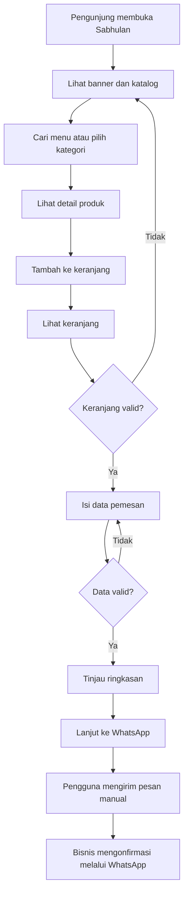

# PRODUCT REQUIREMENTS DOCUMENT (PRD)
# SABHULAN — Katalog Kuliner Online

> **Versi:** 1.0 (draft implementasi)  
> **Tanggal:** 10 Oktober 2026  
> **Status:** Draft — perlu validasi stakeholder  
> **Platform:** Responsive web (desktop, tablet, mobile)  
> **Brand:** Sabhulan  
> **Referensi visual:** `Sabhulan_Logo.png` (ikon bulan sabit + kuliner)  
> **Tujuan dokumen:** Menjadi *source of truth* untuk perancangan dan implementasi di Antigravity / AI coding agent.

---

## 1. Ringkasan produk

Sabhulan adalah website katalog kuliner untuk membantu pelanggan menemukan menu makanan/minuman, menambahkan produk ke keranjang, dan meneruskan ringkasan pesanan melalui WhatsApp bisnis. Pada tahap awal, **tidak ada pembayaran di website** dan **tidak ada kewajiban login sebelum checkout**.

### Masalah yang diselesaikan
- Informasi menu, harga, dan ketersediaan tersebar atau sulit ditemukan.
- Pelanggan harus menanyakan satu per satu produk melalui chat.
- Format pesanan manual sering tidak lengkap atau sulit dibaca.
- Pelanggan membutuhkan pengalaman katalog yang nyaman di ponsel.

### Sasaran utama
1. Pengguna bisa menemukan dan memahami menu dengan cepat.
2. Pengguna bisa menyusun dan mengubah keranjang secara akurat.
3. Pengguna bisa melanjutkan ringkasan pesanan ke WhatsApp dengan satu aksi.
4. Brand Sabhulan tampil konsisten, hangat, menarik, dan mudah dikenali.

### Pengguna
- **Pelanggan (utama):** Melihat menu, mencari, memilih, dan memesan.
- **Pengelola Sabhulan:** Menyediakan data menu dan menerima pesanan via WhatsApp.

---

## 2. Cakupan berdasarkan diagram awal

| Fase | Modul | Subfitur yang TERLIHAT pada diagram |
|---|---|---|
| 1 | Halaman Profil Perusahaan | Banner Utama, Tentang Kami, Kenapa Pilih Kami |
| 1 | Katalog Menu | Pilih Kategori, Detail Produk, Cari Menu |
| 1 | Keranjang Belanja | Tambah ke Keranjang, Ubah Jumlah, Hapus Item |
| 2 | Checkout ke WhatsApp | Isi Data Pemesan, Rincian Pesanan, Kirim ke WhatsApp |
| 3 | Akun Pengguna | Daftar Akun, Masuk & Keluar, Lupa Password |
| 4 | Tampilan Menarik | Tampilan Semua Perangkat, Warna & Gaya Konsisten, Ringan & Cepat |

**Penting:** Diagram memperlihatkan jumlah 24 subfitur, sedangkan hanya 18 nama subfitur terlihat. Enam subfitur lain belum diketahui (2 profil, masing-masing 1 katalog, keranjang, checkout, akun). Jangan menganggap fitur yang belum terlihat telah disetujui. Konfirmasi dengan pemilik produk sebelum mengembangkan tambahan tersebut.

**Pembagian rilis:** Fase 1 adalah fondasi katalog; **MVP pemesanan end-to-end selesai pada Fase 2**. Responsivitas dan kualitas dasar tetap wajib sejak Fase 1, meskipun optimalisasi lanjutan dikelompokkan di Fase 4.

---

## 3. Prinsip produk & guardrails untuk Antigravity

1. Kerjakan sesuai urutan fase. Jangan mengimplementasikan Fase 3/4 sebelum fitur MVP Fase 1–2 stabil, kecuali kualitas teknis dasar.
2. Berikan pengalaman **mobile-first** dan navigasi sederhana.
3. Jangan tambahkan payment gateway, biaya ongkir otomatis, ulasan, loyalty, multi-vendor, admin panel, atau integrasi POS tanpa persetujuan.
4. Guest checkout harus bekerja; autentikasi bukan syarat memesan.
5. Jangan menampilkan status “pesanan berhasil” ketika hanya membuka WhatsApp. Aksi tersebut hanya *handoff* ke WhatsApp; pelanggan masih perlu menekan *Send*.
6. Simpan angka harga sebagai nilai numerik, bukan string terformat. Gunakan format `id-ID` / `IDR` untuk tampilan.
7. Setiap data yang belum disediakan bisnis (nama produk, harga, alamat, nomor WA) harus menggunakan **placeholder/mock data yang jelas**, bukan diklaim sebagai data bisnis nyata.
8. Jangan mengarang API backend atau database yang belum diputuskan. Untuk prototipe, gunakan data lokal dengan lapisan abstraksi yang mudah diganti API.
9. Semua tombol harus mempunyai perilaku nyata; jangan menghasilkan UI dengan aksi palsu.
10. Hindari ketergantungan berat yang tidak diperlukan. Kode harus modular dan mudah dipelihara.

---

## 4. Brand & desain

**Nama:** Sabhulan  
**Konsep logo:** Bulan sabit ceria dengan elemen kuliner; kesan hangat, lezat, ramah keluarga.  
**Aset logo:** `Sabhulan_Logo.png` — tempatkan pada direktori aset proyek, misalnya `public/brand/sabhulan-logo.png`.

### Arah desain (rekomendasi awal, belum final)
- Palet: krem hangat, kuning keemasan, cokelat gelap, dengan warna aksen yang selaras dengan foto makanan.
- Bentuk: rounded cards/buttons, whitespace cukup, foto produk jelas, CTA kontras.
- Tipografi: mudah dibaca; teks isi diutamakan dibanding gaya dekoratif.
- Aksesibilitas: kontras WCAG AA sejauh dapat diterapkan, fokus keyboard terlihat, label form jelas, alt text pada gambar informatif.
- Identitas: gunakan logo lengkap pada header atau beranda; siapkan ikon sederhana untuk favicon jika diperlukan. Jangan mengasumsikan gambar logo ilustratif otomatis terbaca pada ukuran favicon yang kecil.

---

## 5. Kebutuhan fungsional Fase 1

### FR-01 — Beranda & banner
**User story:** Sebagai pengunjung, saya ingin langsung memahami bisnis Sabhulan dan menemukan katalog menu.

**Kebutuhan:**
- Header memuat logo, navigasi menu, dan ikon/tombol keranjang dengan indikator jumlah.
- Hero/banner memuat nama brand, proposisi nilai, visual relevan, dan CTA **Lihat Menu**.
- CTA menuju katalog, baik melalui route `/menu` maupun anchor yang sesuai desain.
- Bagian **Tentang Kami** memperkenalkan usaha menggunakan konten yang dapat diedit.
- Bagian **Kenapa Pilih Kami** menampilkan daftar keunggulan yang disetujui pemilik bisnis.

**Acceptance criteria:**
- Semua tautan navigasi berfungsi.
- Logo dan banner tampil tanpa terpotong pada mobile maupun desktop.
- Informasi brand dapat dibaca tanpa login.

### FR-02 — Katalog & kategori
**User story:** Sebagai pelanggan, saya ingin menyaring menu menurut kategori untuk menemukan makanan yang cocok.

**Kebutuhan:**
- Tampilkan produk dalam grid/kartu: foto, nama, harga, status tersedia, tombol detail/keranjang.
- Tampilkan opsi **Semua Menu** dan kategori yang tersedia.
- Ketika kategori dipilih, daftar produk diperbarui.
- Ketika tidak ada produk, tampilkan *empty state* dan tindakan kembali ke semua produk.

**Acceptance criteria:**
- Hanya item kategori aktif yang tampil ketika filter digunakan.
- Tidak ada error saat kategori kosong.
- Tersedia pembeda visual kategori aktif.

### FR-03 — Pencarian menu
**User story:** Sebagai pelanggan, saya ingin mencari menu berdasarkan nama.

**Kebutuhan:**
- Input pencarian case-insensitive, mengabaikan spasi awal/akhir.
- Boleh dikombinasikan dengan filter kategori; hasil kombinasi harus konsisten.
- Jika kata kunci dihapus, kembali ke hasil filter kategori aktif.
- Tampilkan pesan apabila tidak ada hasil.

**Acceptance criteria:**
- Pencarian menghasilkan item yang relevan berdasarkan nama.
- Saat tidak ada hasil, UI tidak rusak.

### FR-04 — Detail produk
**User story:** Sebagai pelanggan, saya ingin melihat rincian sebelum memilih produk.

**Data minimum:** `id`, `slug`, `name`, `description`, `categoryId`, `price`, `imageUrl`, `isAvailable`.

**Kebutuhan:**
- Detail memperlihatkan foto, nama, deskripsi, harga format rupiah, status ketersediaan.
- Item tersedia dapat ditambahkan ke keranjang.
- Item tidak tersedia menonaktifkan tambah-ke-keranjang dan menjelaskan alasannya.

**Acceptance criteria:**
- Harga sesuai sumber data.
- Produk yang tidak tersedia tidak bisa dibeli.

### FR-05 — Keranjang belanja
**User story:** Sebagai pelanggan, saya ingin mengelola item pesanan sebelum checkout.

**Kebutuhan:**
- Tambah produk tersedia ke keranjang; jika sama, tingkatkan kuantitas (bukan membuat baris ganda).
- Naik/turunkan kuantitas bilangan bulat dengan minimum 1 pada item yang tersimpan.
- Hapus baris item dengan aksi terpisah.
- Perbarui subtotal dan total secara deterministik setiap perubahan.
- Tampilan keranjang kosong menyediakan CTA **Lihat Menu**.
- Pertahankan isi keranjang ketika halaman di-refresh (mis. `localStorage`) untuk guest flow.

**Rumus:** `subtotal = unitPrice * quantity`; `total = Σ subtotal`.

**Acceptance criteria:**
- Badge jumlah sesuai total kuantitas item.
- Tidak ada nilai kuantitas nol/negatif dalam keranjang.
- Perhitungan benar setelah tambah, ubah, atau hapus.
- Refresh tidak menghilangkan keranjang ketika penyimpanan lokal tersedia.

---

## 6. Kebutuhan fungsional Fase 2 — WhatsApp checkout

### FR-06 — Form pemesan
**User story:** Sebagai pelanggan, saya ingin melengkapi informasi pemesan agar pesan mudah diproses.

**Data minimum yang sudah bisa dirancang:**
- `customerName` (wajib, tidak boleh kosong atau hanya spasi).
- `customerNote` (opsional).

**Menunggu konfirmasi:** nomor HP pemesan, alamat, metode ambil/kirim, biaya kirim, waktu pemesanan. Jangan paksakan field-field ini sebelum keputusan bisnis.

**Acceptance criteria:**
- Form tidak bisa dilanjutkan jika data wajib invalid.
- Pesan kesalahan muncul dekat field terkait.
- Keranjang kosong tidak dapat checkout.

### FR-07 — Ringkasan pesanan
**Kebutuhan:**
- Render daftar nama menu, harga satuan, jumlah, subtotal, total, data pemesan, dan catatan (jika ada).
- Perhitungan harus konsisten dengan keranjang.
- Jika memiliki API, lakukan validasi harga dan ketersediaan sebelum handoff.

**Acceptance criteria:**
- Ringkasan cocok dengan item terbaru.
- Tidak ada harga `NaN`, negatif, atau nilai `undefined` yang tampil.

### FR-08 — Handoff WhatsApp
**User story:** Sebagai pelanggan, saya ingin mengirim rincian pesanan dengan cepat melalui WhatsApp.

**Kebutuhan:**
- Gunakan nomor tujuan WhatsApp bisnis dari konfigurasi (`WHATSAPP_BUSINESS_NUMBER`).
- Susun pesan terformat, misalnya:

```text
Halo Sabhulan, saya ingin memesan:

Nama: [Nama Pemesan]

Pesanan:
1. [Nama Menu] x2 — Rp50.000
2. [Nama Menu] x1 — Rp30.000

Total Produk: Rp80.000
Catatan: [Catatan, jika ada]

Mohon konfirmasi ketersediaan dan total akhir. Terima kasih!
```

- Buat URL `https://wa.me/<number>?text=<encodeURIComponent(message)>`.
- Nomor harus dalam format internasional digit saja, misalnya awalan `62` untuk nomor Indonesia, tanpa `+`/spasi. Jangan hardcode nomor placeholder sebagai nomor riil.
- Berikan tombol **Lanjut ke WhatsApp**; sediakan alternatif **Salin Pesanan** jika WhatsApp tidak tersedia.
- Tampilkan pemberitahuan bahwa pengguna masih perlu mengirim pesan dan menunggu konfirmasi dari bisnis.

**Acceptance criteria:**
- WhatsApp diarahkan ke nomor terkonfigurasi dengan pesan berisi rincian yang benar.
- Karakter khusus serta baris baru di-*encode* dengan aman.
- Menekan tombol tidak otomatis menandai pesanan sebagai terkirim atau dibayar.
- Aksi gagal tidak menghapus keranjang.

---

## 7. Kebutuhan fungsional Fase 3 — Akun pengguna

> Fase 3 tidak memblokir rilis MVP. Guest checkout tetap ada.

### FR-09 — Daftar akun
- Izinkan pengguna membuat akun dengan identitas unik (email atau nomor telepon: **TBD**).
- Validasi field wajib dan cegah akun duplikat.
- Penyimpanan password harus menggunakan hashing kuat via penyedia auth/backend yang aman; jangan menulis password plaintext.

### FR-10 — Masuk dan keluar
- Login memvalidasi kredensial pada server/provider auth.
- Logout mengakhiri sesi dan mencabut akses ke halaman privat.
- Sesi yang kedaluwarsa perlu penanganan yang jelas.

### FR-11 — Lupa password
- Pengguna dapat meminta reset melalui kanal identitas terverifikasi.
- Token reset memiliki masa berlaku, hanya bisa dipakai sesuai kebijakan keamanan.
- Respons tidak mengungkap keberadaan akun.

**Acceptance criteria Fase 3:** registrasi valid, login/logout, recovery, dan error handling bekerja; akses guest ke katalog dan checkout tidak berubah.

---

## 8. Kebutuhan nonfungsional & Fase 4

Fase 4 berfokus pada **penyempurnaan** UX dan performa, bukan penundaan kualitas dasar.

### NFR-01 — Responsivitas
- Mobile-first; uji layar kecil, tablet, dan desktop.
- Tidak ada horizontal scroll yang tidak disengaja.
- Tombol dan input memiliki target sentuh yang mudah digunakan.

### NFR-02 — Desain konsisten
- Gunakan sistem token warna, tipografi, spacing, radius, dan shadow.
- Komponen memiliki state hover/focus/disabled/error yang konsisten.
- Layout katalog, keranjang, dan checkout menggunakan komponen reusable.

### NFR-03 — Performa
- Gunakan gambar teroptimasi dan lazy loading sesuai kebutuhan.
- Target awal Core Web Vitals p75: LCP ≤ 2,5 s; INP ≤ 200 ms; CLS ≤ 0,1.
- Hindari paket/dependency tidak perlu.

### NFR-04 — Keamanan & privasi
- HTTPS pada production.
- Hindari injeksi/XSS; jangan menyisipkan teks pengguna sebagai HTML mentah.
- Validasi input di UI dan server bila server tersedia.
- Kumpulkan data pribadi seminimal mungkin; jangan kirim nama/telepon pengguna ke analytics.
- Simpan secret di server/env, bukan source control.

### NFR-05 — Keandalan
- Tampilkan loading/empty/error state.
- Jangan hilangkan keranjang ketika operasi nonkritis gagal.
- Semua tindakan utama punya feedback yang jelas.

---

## 9. Struktur halaman / route usulan

| Route | Halaman | Fase |
|---|---|---|
| `/` | Beranda, hero, tentang, keunggulan | 1 |
| `/menu` | Katalog, pencarian, filter | 1 |
| `/menu/:slug` | Detail produk | 1 |
| `/cart` | Keranjang | 1 |
| `/checkout` | Data pemesan, ringkasan, WhatsApp | 2 |
| `/register` | Registrasi | 3 |
| `/login` | Login | 3 |
| `/forgot-password` | Lupa password | 3 |
| `/reset-password` | Reset password | 3 |

> Route dapat diadaptasi pada framework terpilih, tetapi alur pengguna harus tetap sama.

---

## 10. Model data minimal (framework-agnostic)

```ts
type Category = {
  id: string;
  slug: string;
  name: string;
  sortOrder?: number;
};

type Product = {
  id: string;
  slug: string;
  name: string;
  description: string;
  categoryId: string;
  price: number;        // integer rupiah, >= 0
  imageUrl: string;
  isAvailable: boolean;
};

type CartItem = {
  productId: string;
  quantity: number;     // positive integer
};

type CheckoutDetails = {
  customerName: string;
  customerNote?: string;
};
```

**Alasan desain cart:** Gunakan `productId` + `quantity` sebagai sumber isi keranjang; tampilkan nama/harga dari katalog terkini jika tersedia. Untuk backend production, harga dan ketersediaan harus divalidasi dari sumber data tepercaya sebelum checkout.

---

## 11. Arsitektur & struktur direktori (rekomendasi, bukan kewajiban)

Untuk proyek baru, pilihan umum adalah React + TypeScript + framework seperti Next.js/Vite sesuai kebutuhan deployment. Jangan anggap stack ini final sampai dikonfirmasi.

```text
src/
  app/ or pages/             # route & page composition
  components/
    layout/                  # Header, Footer, Navigation
    ui/                      # Button, Input, Modal, EmptyState
    menu/                    # ProductCard, CategoryFilter, SearchBar
    cart/                    # CartItemRow, CartSummary
    checkout/                # CustomerForm, OrderPreview
  data/                      # mock menu/categories (sementara)
  lib/
    currency.ts              # formatRupiah
    whatsapp.ts              # createWhatsAppMessage, buildWhatsAppUrl
    storage.ts               # safe cart persistence
  hooks/ or state/           # cart state
  types/                     # TypeScript models
public/
  brand/
    sabhulan-logo.png
  images/
    products/
```

### Rekomendasi implementasi
- Pisahkan UI dari logika bisnis (cart, total, format pesan).
- Gunakan satu fungsi murni untuk menghitung total dan satu fungsi untuk menyusun pesan WA agar mudah dites.
- Tangani `localStorage` dengan aman pada rendering server/client.
- Buat mock data yang jelas dan mudah diganti oleh API/CMS kelak.
- Sediakan README mengenai setup, env, scripts, dan batasan MVP.

---

## 12. User flow inti



### Error / edge cases
- Pencarian tanpa hasil → empty state.
- Produk tidak tersedia → tombol add disabled.
- Keranjang kosong → checkout disabled.
- Nama pemesan kosong → inline validation.
- Harga/produk berubah → tampilkan data terkini dan minta review ulang.
- WhatsApp tidak bisa dibuka → tampilkan opsi salin pesan/kontak bisnis.
- Local storage tidak tersedia → aplikasi tetap bisa beroperasi selama sesi aktif bila memungkinkan.

---

## 13. QA, acceptance test & definition of done

| ID | Skenario | Hasil yang diharapkan |
|---|---|---|
| UAT-01 | Klik CTA hero | Berpindah ke katalog |
| UAT-02 | Filter berdasarkan kategori | Hanya produk relevan muncul |
| UAT-03 | Cari nama produk | Hasil cocok dan state kosong benar |
| UAT-04 | Buka detail | Nama, foto, harga, deskripsi benar |
| UAT-05 | Tambah item dua kali | Satu baris, quantity bertambah |
| UAT-06 | Ubah jumlah item | Total terkalkulasi ulang |
| UAT-07 | Hapus item terakhir | Keranjang kosong + CTA |
| UAT-08 | Refresh halaman | Keranjang tetap tersimpan jika storage tersedia |
| UAT-09 | Checkout tanpa nama | Validasi tampil dan WA tidak dibuka |
| UAT-10 | Checkout valid | Link WA dan isi pesan tepat |
| UAT-11 | Aplikasi di mobile | Navigasi, kartu, keranjang, form tidak rusak |
| UAT-12 | Refresh/ubah route | Tidak ada runtime error kritis |

### Definition of Done
- Semua acceptance criteria fase terkait terpenuhi.
- Tidak ada error kritis pada browser console.
- Responsif pada mobile dan desktop yang disepakati.
- Aksesibilitas dasar, loading/empty/error state tersedia.
- Kode tervalidasi lint/test dan skenario inti teruji.
- README dan instruksi environment tersedia.

---

## 14. Rencana eksekusi untuk Antigravity

### Tahap A — Inisialisasi
1. Baca PRD ini, identifikasi keputusan terbuka.
2. Inspeksi proyek yang sudah ada; jangan menimpa konfigurasi atau file kerja tanpa alasan.
3. Konfirmasi stack jika belum ada; jika diminta langsung membangun demo, pilih stack yang sederhana dan dokumentasikan asumsi.
4. Simpan logo di direktori aset dan buat token brand.

### Tahap B — Fase 1
1. Setup layout, header, footer, navigation, design tokens.
2. Implementasi beranda dan tiga section yang terlihat.
3. Implementasi mock data kategori dan produk.
4. Katalog + search + filter + detail.
5. Cart state + persistence + kalkulasi + empty state.
6. Uji acceptance test UAT-01 s.d. UAT-08, UAT-11/12.

### Tahap C — Fase 2
1. Checkout form dan validasi.
2. Ringkasan pesanan.
3. Message formatter dan builder URL WhatsApp.
4. Fallback salin pesan dan instruksi konfirmasi.
5. Uji UAT-09/10 serta regresi Fase 1.
6. Rilis MVP bila disetujui.

### Tahap D — Fase 3 (setelah keputusan layanan auth)
1. Tentukan identitas login dan auth provider.
2. Registrasi, login/logout, password recovery.
3. Uji keamanan dan regresi guest checkout.

### Tahap E — Fase 4
1. Audit UI responsive, accessibility, dan consistency.
2. Optimasi aset, runtime, SEO dasar.
3. Pengukuran Lighthouse/Core Web Vitals dan perbaikan terukur.

**Instruksi untuk coding agent:** Pada akhir setiap tahap, rangkum file yang dibuat/diubah, fitur yang selesai, pengujian yang dijalankan, asumsi yang dipakai, dan hal yang masih membutuhkan keputusan. Jangan mengklaim telah menjalankan pengujian jika belum benar-benar dilakukan.

---

## 15. Keputusan yang belum ditetapkan

- Nomor WhatsApp bisnis.
- Konten profil, keunggulan, dan CTA final.
- Daftar produk, kategori, harga, foto, ketersediaan.
- Apakah tersedia opsi pickup/delivery, alamat, dan biaya terkait.
- Cara pembaruan data katalog (file statis/API/CMS/admin).
- Enam subfitur tersembunyi pada diagram.
- Stack final, hosting, domain, dan target waktu peluncuran.
- Identitas login dan penyedia autentikasi Fase 3.

---

## 16. Di luar cakupan tanpa persetujuan

Online payment, checkout otomatis tanpa WhatsApp, pelacakan pesanan otomatis, kurir, POS, multi-vendor, review/rating, voucher, loyalty, dashboard admin, order history, personalisasi lanjutan, dan notifikasi otomatis.

---

## 17. Instruksi singkat untuk memulai di Antigravity

Gunakan prompt berikut dengan menyertakan file PRD ini dan logo:

```text
Baca PRD_Sabhulan_Antigravity.md sebagai sumber kebutuhan utama.
Bangun website "Sabhulan" secara bertahap, mulai Fase 1 lalu Fase 2.
Gunakan Sabhulan_Logo.png sebagai aset brand.
Prioritaskan pengalaman mobile-first, katalog, search/filter, detail produk,
keranjang persisten, dan checkout via WhatsApp tanpa kewajiban login.
Jangan tambahkan fitur di luar scope tanpa persetujuan.
Gunakan mock data yang ditandai jelas untuk informasi bisnis yang belum tersedia.
Sebelum coding, laporkan rencana implementasi dan asumsi teknis.
Setelah coding, laporkan perubahan file, cara menjalankan, dan hasil pengujian.
```

---

**Status:** PRD implementasi versi draft. Perlu validasi data bisnis dan keenam subfitur yang belum terlihat pada diagram sebelum final sign-off.
